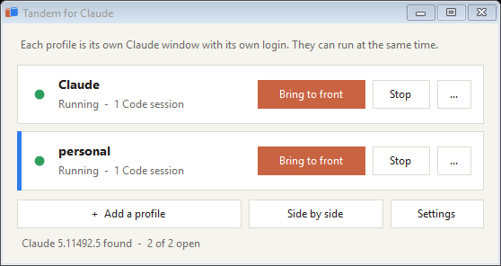

# Tandem for Claude

**Run several Claude Desktop accounts side by side on Windows. Free and open source.**

Claude Desktop lets you sign in to one account at a time. Tandem opens it a second (or third) time with a separate login, so your work and personal accounts can both stay open, each in its own window.



> Unofficial tool. Not made by, affiliated with or endorsed by Anthropic. "Claude" is a trademark of Anthropic.

## Download

1. Get `Tandem.exe` from the [latest release](../../releases/latest).
2. Put it in a folder where it can stay, for example `Documents\Tandem`. Shortcuts point to wherever the file is.
3. Double-click it.

The file is not code-signed, so the first time Windows may show "Windows protected your PC". Click **More info**, then **Run anyway**. If you would rather not trust a download, [build it yourself](#build-it-yourself) in a few seconds.

**You need:** Windows 10 or 11, and [Claude Desktop](https://claude.ai/download) installed and opened once. Nothing else: no installer, no runtime, no account.

## How to use it

1. Open Tandem. Your normal Claude is already in the list.
2. Click **Add a profile** and give it a name, such as `personal`.
3. Click **Launch**. A new Claude window opens. Sign in there with your other account.

From then on, both windows open and close independently. Each profile keeps its own login, chats, settings and Claude Code history.

## What it can do

- **Launch, bring to front, stop and relaunch** each account.
- **See what is running**, including how many Claude Code sessions each window has.
- **Colour border per account** so you can tell the windows apart at a glance (Windows 11).
- **Side by side**: tile the open Claude windows across the screen with one click.
- **Desktop shortcut per account**, and optional **start with Windows**.
- **Claude Code terminal per account**: a terminal where the `claude` command uses that profile's settings.
- **Tray icon** (optional) with quick access to every profile.
- **Rename, add and remove** profiles. Removing one from the list never deletes its data.

It also works from the command line:

```
Tandem.exe --launch NAME      start one profile, or bring it to the front
Tandem.exe --stop NAME        stop one profile and everything it started
Tandem.exe --side-by-side     put the open Claude windows next to each other
Tandem.exe --list             print the profiles and their state
```

## How it works

There is no trick and nothing is modified. For every extra profile, Tandem starts the Claude Desktop that is already installed, with two additions:

| Setting | Effect |
| --- | --- |
| `--user-data-dir=<profile folder>` | That window keeps its own login and app settings. |
| `CLAUDE_CONFIG_DIR=<profile folder>\.claude` | Claude Code in that window keeps its own memory, skills and history. |

Your normal Claude is started with no additions at all.

## Where your data is

| What | Where |
| --- | --- |
| Tandem's settings | `%USERPROFILE%\.tandem\config.json` |
| Each new profile | `%USERPROFILE%\.tandem\profiles\<name>` |

Deleting `Tandem.exe` leaves all of that in place. To remove a profile completely, remove it from the list and then delete its folder.

If you used another profile manager before, Tandem looks for its profile folders on first start (`%APPDATA%\ClaudeProfiles` and `%APPDATA%\MultiDeskClaude-Profiles`) and adds them to the list, so you keep those logins.

## Privacy

Tandem never goes online. It has no telemetry, no update check, no account and no licence check. It reads the list of running Claude processes and writes its own settings file. That is all.

## Good to know

- **Use accounts you are allowed to use.** Each account stays subject to Anthropic's terms. Tandem is for people with more than one legitimate account, such as work and personal.
- **Profiles do not share anything.** Claude Code memory, skills and connectors set up in one profile are not in the other.
- **One mouse, one screen, one GPU.** Tasks that control the computer or use the graphics card heavily should run in one window at a time.
- **Stop is a hard stop.** It closes that Claude window and ends whatever it was running.
- **Tested with** the Microsoft Store build of Claude Desktop 5 on Windows 11. The older installer build is detected too, but has not been tested.

## Build it yourself

Tandem is a single small C# program. It builds with the compiler that ships with Windows, so there is nothing to install:

```
build.cmd
```

The result is `dist\Tandem.exe`. The icon is drawn by `assets\make_icon.py` (needs Python with Pillow) and is already included.

Every release on GitHub is built from this source by the workflow in `.github/workflows/build.yml`.

## Licence

[MIT](LICENSE). Free to use, change and share.
